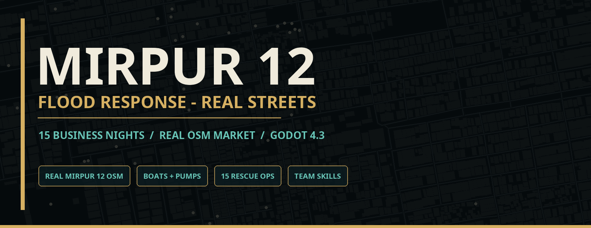
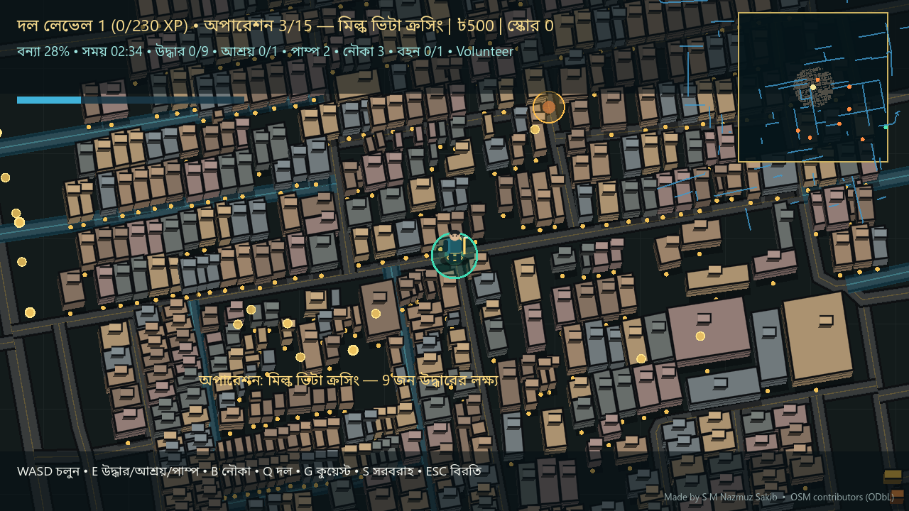
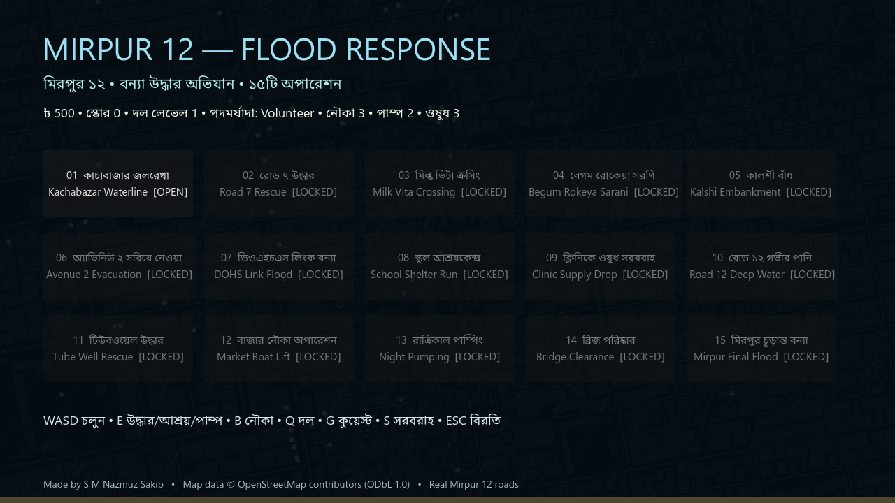
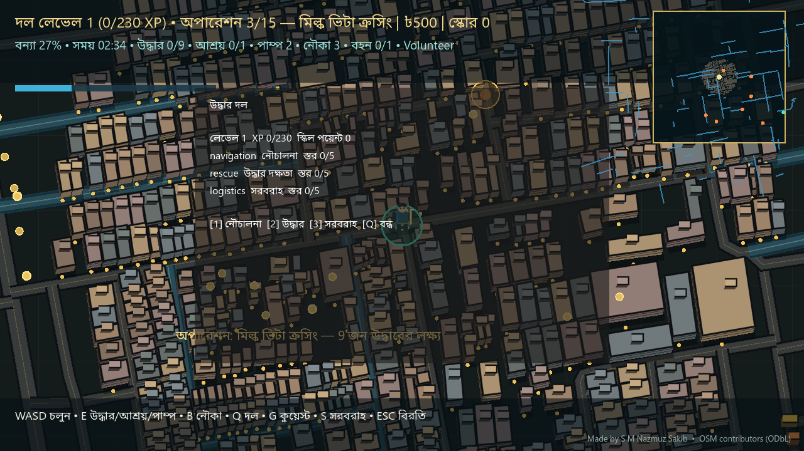
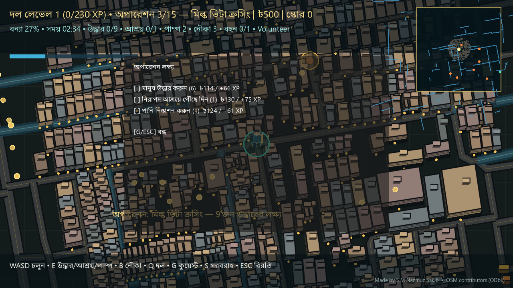
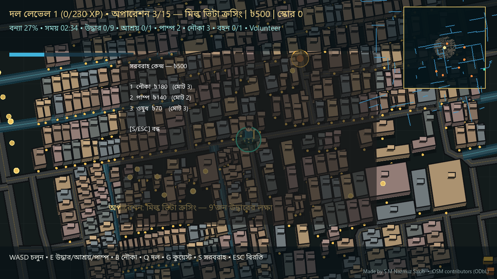
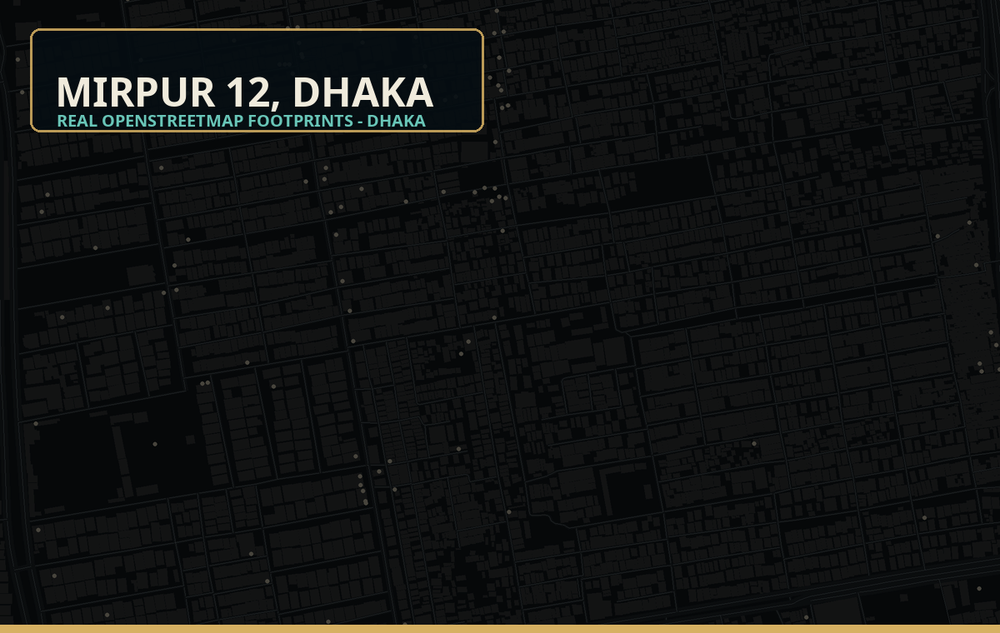

# Mirpur 12 — Flood Response

[](https://github.com/Sakibpedia/mirpur12-flood-response/actions/workflows/build_exes.yml)



A **2.5D emergency-rescue game** on the real streets of Mirpur 12, Dhaka. Monsoon floods trap residents; command a rescue team, carry people to shelters, pump water off roads and complete 15 escalating operations. Godot 4.3.



## Play

Download `Mirpur12Flood.exe` from the [Releases page](https://github.com/Sakibpedia/mirpur12-flood-response/releases) and double-click it. If SmartScreen warns, choose **More info → Run anyway** (unsigned build).

## Real Mirpur 12 urban data

The playable area comes from an OpenStreetMap extract of Mirpur 12 (23.8154–23.8354 N, 90.3597–90.3797 E):

- **764 real roads** — 558 residential, 37 primary, 19 tertiary, 6 secondary, plus service lanes and paths. Named streets include Begum Rokeya Sarani, Kachabazar Road, Milk Vita Road, Arambag Main Road, Kalshi Flyover, Road 1–12, Avenue 2, and the numbered "line" lanes.
- **20,025 building footprints** (1,500 nearest used for collision; 600 drawn for GPU efficiency).
- **1,098 amenities**, of which **437 are shelters** (clinics, hospitals, schools, pharmacies, water points).
- Shops/relief posts are placed along named roads; flooded segments use a deterministic subset of real road geometry.

Regenerate: `python tools/build_mirpur_map.py`.

## Gameplay

- **Rescue** stranded residents with `E` (up to `carry capacity` at a time).
- **Evacuate** them to real OSM shelters; score increases for each person delivered.
- **Pump** flooded road segments with `E` when a pump is available, lowering the flood level.
- **Boat mode** (`B`) restores movement speed on flooded roads.
- **Rising water** is the timer: if the flood reaches 100%, the operation fails.
- **Supplies** (`S`): buy boats, pumps and medicine.
- **Team RPG**: XP, levels, skill points and three skills — navigation (flood speed), rescue (carry capacity), logistics (pump power).
- **Three quests per operation** plus grades, unlocks and persistent saves in `user://mirpur12_flood.cfg`.

## Screenshots (rendered from the running game)

| Operation select | Flooded streets | Team skills |
|---|---|---|
|  |  |  |

| Quests | Supplies | Summary |
|---|---|---|
|  |  |  |

| Real OSM map | Sprites |
|---|---|
|  |  |

## Controls

```
WASD / arrows move    Shift sprint    E rescue / shelter / pump
B boat mode           Q team skills   G quests       S supplies
ESC pause / close panel
Summary: R retry, N next operation, M menu
```

## Build and test

```powershell
python tools/build_mirpur_map.py
python tools/make_visuals.py
godot --headless --path . --import
godot --headless --path . res://tools/test/CityTest.tscn
godot --headless --path . res://tools/test/EconomyTest.tscn
powershell tools/test/run_all.ps1 -Godot "C:\path\to\Godot_v4.3-stable_win64_console.exe"
godot --headless --path . --export-release "Windows Desktop"
```

Every suite prints `PASS`. Results: [docs/VERIFICATION.md](docs/VERIFICATION.md).

## Credits

**Made by S M Nazmuz Sakib.** Game design, code and generated art are by S M Nazmuz Sakib.
Map data © [OpenStreetMap contributors](https://www.openstreetmap.org/copyright), ODbL 1.0.
Fonts: Noto Sans / Noto Sans Bengali (SIL OFL 1.1).
No open-source license is granted for the original work.
